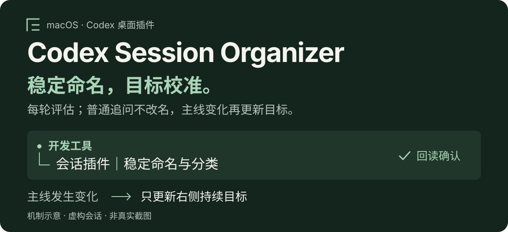

# Codex Session Organizer

<p align="center">
  
</p>

给 **macOS Codex 桌面端**用的轻量插件。首次完成实质任务时，把新会话命名为「主题对象｜持续目标」，归入你选择的侧栏分区；后续每轮评估主线：普通追问沿用标题，长期目标实质变化时只更新右侧目标；分区保持不变。

**macOS 桌面端** · **Python 3.9+** · **MIT 开源** · **本地状态，无额外 API Key**

[安装](#安装) · [工作原理](#工作原理) · [使用指南](docs/usage.md) · [v0.2.0 下载](https://github.com/Stanley-baby/codex-session-organizer/releases/tag/v0.2.0)

## 效果示例

**每轮判断是否需要更新，不是每轮都改名。**

| 你在做什么 | 标题示例 | 分区示例 |
| --- | --- | --- |
| 排查插件 → 修复 → 测试 | 会话插件｜稳定命名与分类 | 开发工具 |
| 写文案 → 改版 → 交付 | 产品文案｜发布内容打磨 | 内容创作 |
| 读论文 → 整理笔记 | 检索增强｜原理与实践 | 学习研究 |

上图和表格均为虚构示例。分区名称与归属描述由你决定；标题目标不超过 24 个字符。

## 安装

需要支持插件 Hooks 和原生侧栏管理工具的 **macOS Codex 桌面端**，以及可运行的 `codex` 命令和 Python 3.9+。

### 1. 安装插件

```sh
codex plugin marketplace add Stanley-baby/codex-session-organizer --ref v0.2.0
codex plugin add codex-session-organizer@codex-session-organizer
```

通过 GitHub marketplace 分发，固定到 `v0.2.0` 以便复现；不是官方公共插件目录的已审核上架项目。已有旧版安装请先看[更新步骤](docs/usage.md#更新)。

### 2. 设置分区，审核 Hooks

在 Codex 插件设置中运行 **Setup**，或在会话中选择本插件的 `session-organizer-setup` 技能，发送：

```text
请使用 Codex Session Organizer 的设置技能初始化。
先读取我的侧栏，与我确认分区名称和归属描述，再复用或创建分区。
只整理初始化之后的新会话，保留历史会话、项目和置顶状态。
设置完成后告诉我如何审核两个 Hook，并验收普通追问保持、长期目标变化时更新。
```

设置技能会检查环境、确认分类、读取真实分区 ID，并保存本机配置。缺少分区时，经你同意后创建。

随后在 Codex 的 **`/hooks`** 中审核并信任本插件的 `UserPromptSubmit` 和 `PostToolUse` 两个 Hook。安装和启用不会自动完成信任；必要时保存工作后重开桌面应用。

### 3. 新开会话，试三轮

初始化会话不在接管范围，请另开一个新会话，**直接在输入框发送**：

1. 「给我三条 Codex 多会话管理建议，每条不超过 20 字。」任务完成后，查看标题与分区。
2. 在同一会话追问：「把第一条改得更口语化，其他保持不变。」确认标题与分区保持不变。

3. 明确补充：「目标改为给团队交付一份可长期维护的会话管理规范，不再只是个人建议；请给出规范初稿。」完成后核对左侧主题对象不变、右侧目标反映新主线，分区不变。

语义判断由模型完成；检查更新是否合理，不要求逐字匹配某个示例标题。工具转发消息不替代真实输入验收。

## 工作原理

<p align="center">
  
</p>

**每轮评估 → 完成用户任务 → 必要时更新目标 → 回读记账。** Hook 提供规则，模型判断语义，原生工具执行；侧栏回读吻合后才记录成功。

- **稳定校准**：结合整段主线和最新明确目标；普通补充、修复、测试、交付步骤和临时支线不触发改名。长期目标明确扩大、转向或过时，才更新右侧，左侧主题对象保持不变。
- **分区独立**：分区仍为一次确认，不随每轮目标变化来回移动。标题更新先读取当前侧栏，同轮回读吻合才确认；每轮最多确认一次，失败不循环重试。
- **保留人为选择**：已观察到的手动改名和用户明确指定的标题受保护；只有用户明确要求才恢复自动校准。保留自定义分区、项目分区与置顶。
- **只接管新会话**：按首次初始化时间过滤 UUIDv7 创建时间，不批量处理历史会话。
- **状态留在本机**：Python 标准库、文件锁和原子写入；脚本不调用第三方接口，不直接写聊天数据库。

## 日常使用

直接告诉设置技能：「检查插件」「调整分类」「暂停自动整理」或「恢复自动整理」。调整分类保留首次接管时间和已有完成状态。也可以明确说「保护当前标题」或「恢复自动目标校准」。

高级配置、管理命令及状态目录说明见[使用指南](docs/usage.md#配置诊断与暂停)。模型执行与数据处理仍遵循你的 Codex 产品及账号设置，详见[数据说明](PRIVACY.md)。

### 更新

当前 CLI 切换固定版本时需先移除同名安装源再重新添加；按[更新步骤](docs/usage.md#更新)操作，保留状态目录，在 `/hooks` 检查更新后的定义是否需要重新审核。

### 卸载与回退

先让设置技能暂停插件，再执行：

```sh
codex plugin remove codex-session-organizer@codex-session-organizer
```

卸载保留本地状态和已整理的侧栏。移除安装源、还原标题与分区的步骤见[卸载与回退](docs/usage.md#卸载与回退)。

### 从个人内联 Hook 版本迁移

先保留旧版备份，按旧版说明仅移除它自己的两条 Hook，再初始化新版并验收。两套整理器不要同时启用；检测到旧版注册时，新版会停止初始化。[查看迁移与恢复步骤](docs/usage.md#从个人内联-hook-版本迁移)。

## 支持范围

`v0.2.0` 为公开测试版，面向 **macOS Codex 桌面端**。受测客户端为 codex-cli `0.162.0-alpha.17.2`；Windows、Linux、远程主机及 CLI 内的侧栏整理尚未验收。

目标变化的语义判断、命名与分类由模型完成，不是确定性强制规则；24 字是提示目标。每轮会增加管理上下文与必要的侧栏读取，不另接模型服务。第一次侧栏观察前的手动改名可能没有机器标记；缺少原生工具时跳过整理，正常用户任务继续。[完整兼容性说明](docs/usage.md#支持范围) · [故障排查与已知边界](docs/usage.md#故障排查)。

**验证记录**：新增动态目标、手动保护、同轮回读及旧状态兼容测试；具体数量、隔离安装结果与真实桌面验收边界见验证说明。每位用户仍需完成自己环境的三轮真实输入验收。[验证说明](docs/verification.md) · [自动测试](https://github.com/Stanley-baby/codex-session-organizer/actions)。

## 开发与贡献

```sh
python3 -m unittest discover -s tests -v
sh -n hooks/run.sh scripts/python.sh
```

运行时无需第三方 Python 依赖，测试使用合成 ID 和隔离 `CODEX_HOME`。[贡献说明](CONTRIBUTING.md) · [变更记录](CHANGELOG.md)。

官方机制：[插件与 marketplace](https://developers.openai.com/plugins/build/plugins) · [Hooks 事件与信任](https://learn.chatgpt.com/docs/hooks)。本项目与 OpenAI 无隶属关系。

## 许可证

[MIT](LICENSE) · Copyright © 2026 Stanley-baby。
